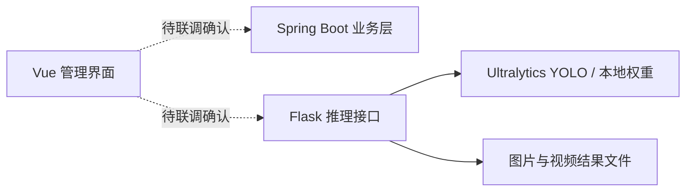

# 作物病害识别：本地项目架构阅读

本案例基于本地 Flask、Spring Boot、Vue 项目目录的有限源码阅读。公开的是重新撰写的架构说明，不含原始数据库、图片、模型权重或业务系统源码。未运行模型，未验证准确率，不能作为已部署成果或原创检测算法的证明。

## 已观察到的功能

Flask 入口使用 Ultralytics YOLO，提供单图、批量图片、视频和摄像头预测路由；Socket.IO 用于连接事件。代码引用本地权重目录以及结果文件上传辅助函数。Vue 前端 README 指向 vue-next-admin 模板。同目录含 Spring Boot 工程和 SQL 文件；本次没有导入数据库，也未验证完整业务链路。

实线为入口代码可观察的调用方向，虚线表示尚未验证的系统集成关系。

## 值得展示的工程主题

1. **任务隔离**：当前入口使用共享实例字段、固定输出路径。并发用户可能覆盖状态或文件。可改造为每请求独立目录与任务 ID。
2. **输入边界**：图片 URL、目录与权重名称来自请求。应使用权重白名单、URL 来源限制、文件大小限制和受控路径解析。
3. **推理生命周期**：视频任务适合后台队列，显式记录排队、运行、完成、失败、取消状态，避免长请求阻塞。
4. **结果可追踪**：记录模型版本、阈值、输入摘要和推理耗时；输出检测结果不等于病害诊断结论。
5. **评估设计**：按采集批次或地块划分数据，检查泄漏，报告逐类指标和失败样例；本次没有真实评测数据。

这些是后续改造建议，不声称已实现。

## 来源与公开边界

- [vue-next-admin](https://gitee.com/lyt-top/vue-next-admin)：本地前端 README 指明的模板来源。
- [Ultralytics](https://github.com/ultralytics/ultralytics)：入口代码导入的检测框架；如未来分发其代码或模型，须核对相应版本与许可要求。
- 本案例没有重新分发上述第三方实现，也不将模板和 YOLO 算法记为个人原创。

本次先展示可核实的架构阅读。可运行的真实病害检测展示仍需要明确的数据来源、权重许可、隔离部署和评估记录。
