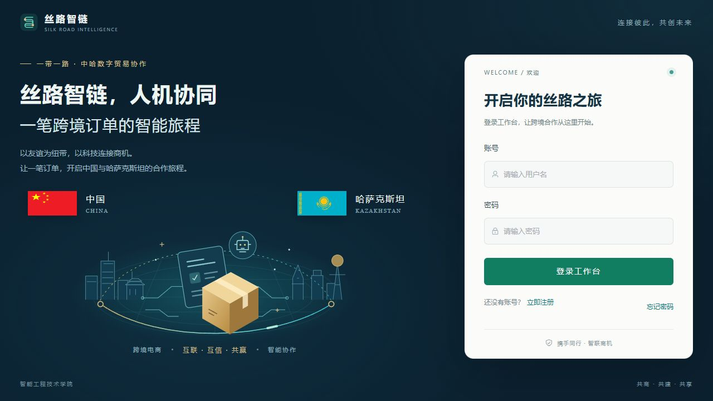
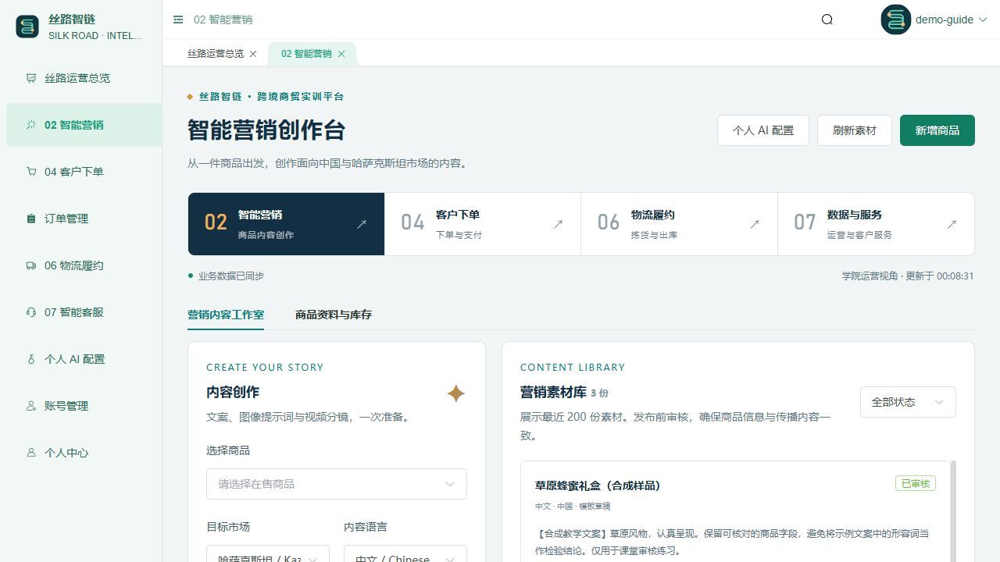
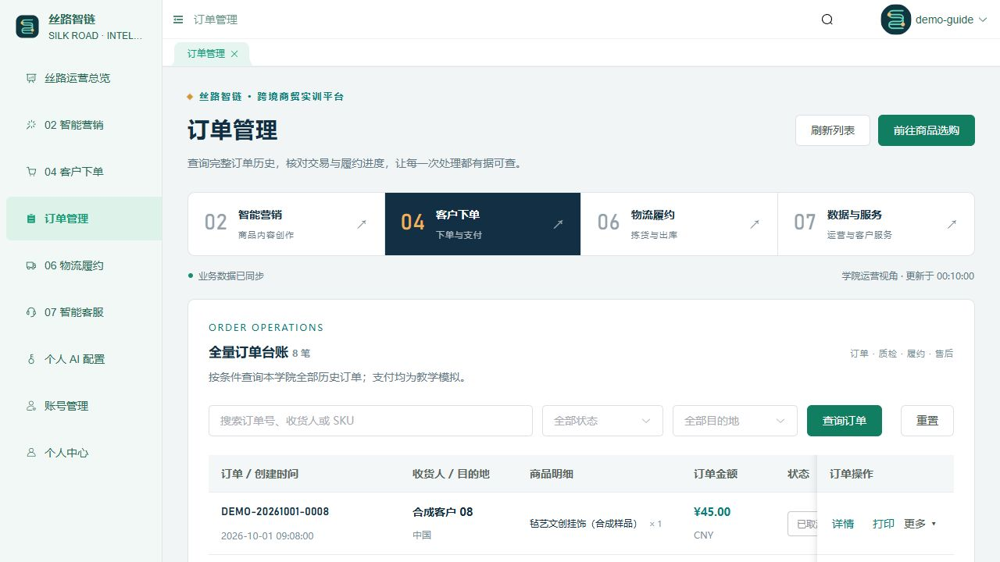

# Silk Road Intelligence / 丝路智链

[Bilingual case / 双语案例](https://guhang2011.github.io/cases/silkroad/) · [Portfolio / 个人首页](https://guhang2011.github.io/)

An engineering case from a cross-border commerce teaching system adapted from an existing Vue 3 + Spring Boot + MySQL application. It connects marketing, ordering, quality checks, logistics simulation and customer service. This directory publishes case notes and screenshots, rather than the full application.

这是在既有 Vue 3 + Spring Boot + MySQL 应用上改造的跨境电商教学案例，以一笔订单连接营销、下单、质检、物流仿真和客服。本目录公开案例笔记与截图，不包含完整应用。

## Interface Gallery / 界面画廊

Screenshots show the actual frontend. Business screens use synthetic teaching records; login fields are empty. Images are not evidence of production deployment or physical robot operation.

截图来自真实前端，业务页面采用合成教学记录，登录字段为空；不代表生产部署或机器人实机运行。

| Screen / 界面 | What to inspect / 阅读重点 |
| --- | --- |
| [Desktop login / 桌面登录](../../assets/silkroad/login-desktop.jpg) | China–Kazakhstan theme, empty login fields / 中哈合作主题与空登录字段 |
| [Mobile login / 手机登录](../../assets/silkroad/login-mobile.jpg) | Responsive entry and readable form / 响应式入口与表单可读性 |
| [Marketing / 智能营销](../../assets/silkroad/marketing-desktop.jpg) | Product-linked drafts, multilingual copy and review / 商品关联草稿、多语文案与审核 |
| [Orders / 订单管理](../../assets/silkroad/orders-desktop.jpg) | Historical search, saved snapshots and permitted actions / 历史查询、保存快照与状态允许的操作 |
| [Fulfillment / 物流履约](../../assets/silkroad/fulfillment-desktop.jpg) | Task status progress and teaching simulation events / 任务状态进度与教学仿真事件 |

## One Order / 一笔订单

1. Maintain a product, prepare Chinese / English / Kazakh marketing drafts, and review content before sharing. Editing approved content returns it to draft. / 维护商品，准备中、英、哈营销草稿，审核后共享；修改已审核内容会回到草稿。
2. Submit a cart. The server recalculates prices and reserves inventory transactionally. A pending-payment cancellation returns stock once. / 提交购物车后由服务端计价并在事务中预留库存；取消待支付订单仅返还一次库存。
3. Complete simulated payment and record a quality-check result. Only a passed result permits fulfillment-task creation. / 模拟支付后登记质检，仅合格订单可以创建履约任务。
4. Run inspection, locating, picking and dispatch in simulation. Events advance in order; a failed task returns to the queue on retry. / 按顺序模拟巡检、定位、抓取与出库；失败任务重试后回到队列起点。
5. Consult authorized product, order and policy information; record a human after-sales resolution. / 基于授权商品、订单和政策咨询，售后由人工记录结论。

## Engineering Contracts / 工程契约

[Order-consistency note / 订单一致性笔记](order-consistency.md) · [Structured verification record / 结构化验证记录](verification.json)

| Decision / 决策 | Contract / 契约 |
| --- | --- |
| State / 状态 | QC must pass before creating a task. Events follow `QUEUED → INSPECTING → LOCATING → PICKING → COMPLETED`; failures and retries are explicit. / 质检合格后才建任务，事件顺序、失败和重试均明确。 |
| Access / 权限 | Customers see their own orders, tasks and after-sales records; administrators remain within their college. Detail and print requests check access again. / 客户限本人，管理员限本学院；详情与打印请求重新检查权限。 |
| Idempotency / 幂等 | A user-scoped order `requestId` must retain the same content. Reusing it with different content is rejected. Task `eventId` prevents duplicate advancement. / 订单请求 ID 按用户隔离，重复 ID 内容不同则拒绝；事件 ID 防止重复推进。 |
| Inventory / 库存 | Server prices and transactional reservations define the order. Product editing and stock replenishment are separate operations. / 服务端价格与事务库存预留确定订单；商品编辑与补货分离。 |
| Service context / 客服上下文 | Product, authorized-order and policy context includes sources; recipient names and addresses are excluded from model context. / 提供商品、授权订单与政策来源，模型上下文排除收货姓名、地址。 |

The overview refreshes every five seconds. Its recent lists are limited to 200 entries, while administrator order pagination and order details cover full authorized history. / 总览每五秒轮询，近期列表最多 200 条；管理员订单分页和详情覆盖全部授权历史。

## Existing Verification Record / 既有验证记录

Record date: **2026-10-15**. The portfolio preparation did not rerun these backend tests. The record reports **41 passed, 0 failures, 0 errors and 0 skipped**.

记录日期为 **2026-10-15**；本次作品集整理未重跑这些后端测试。既有记录为 **41 项通过，失败、错误、跳过均为 0**。

| Area / 范围 | Passed / 通过 | Scope / 覆盖 |
| --- | ---: | --- |
| Commerce workflow / 丝路业务 | 9 | Pricing, stock contention, idempotency, access, QC, events, retry and history / 计价、库存竞争、幂等、权限、质检、事件、重试与历史访问 |
| Personal AI / 个人 AI | 12 | Mock client, source/format checks, context and failures / 模拟客户端、来源格式、上下文与失败 |
| Registration & recovery / 注册找回 | 11 | Role protection, one-use tokens, session revocation and mock SMTP / 角色保护、一次性令牌、会话撤销与模拟 SMTP |
| Sessions / 会话 | 6 | Authentication-service regression / 认证服务回归 |
| Capacity filter / 容量过滤器 | 3 | Concurrency limits, including shared AI slots / 并发限制与共享 AI 名额 |

The record also reports a successful frontend production build. Tests used isolated MySQL and mocked external services. This is not a 500-user end-to-end capacity result. / 同一记录还记载前端生产构建成功；测试使用隔离 MySQL 与模拟外部服务，不代表 500 人全链路容量结果。

## Scope and Provenance / 范围与来源

- Simulated payments move no real funds. Logistics simulation does not control hardware; physical adapters, device identity and safety controls need separate integration. / 模拟支付不扣真实资金，物流仿真不控制硬件；物理适配器、设备身份与安全控制需独立联调。
- Marketing supports explicit template or personal text-model modes. Image/video support prepares prompts, storyboards and reviewed external HTTPS media, rather than generating media. Service uses structured retrieval, not vector RAG. / 营销区分模板与个人文本模型模式；图片视频支持提示词、分镜和经审核的外部 HTTPS 素材，不生成媒体；客服为结构化检索，不是向量 RAG。
- Order printing is a teaching document, not an invoice or payment proof. Email delivery, paid models, carriers and physical robots are outside the stated local checks. / 打印为教学文档，不是发票或支付凭证；真实邮件、付费模型、承运商与机器人不在上述本地验证范围内。
- This case documents the adapted system and its decisions. It does not establish that one person independently authored the underlying application or every asset. / 本案例记录改造后的系统与设计，不据此认定底层应用及全部素材由个人独立完成。
- The frontend reuses the MIT-licensed `vue-next-admin` template. The adaptation also reuses the existing college application's account and college-isolation foundation. / 前端复用 MIT 许可的 `vue-next-admin` 模板，改造同时复用既有学院应用的账号与学院隔离基础。

### Design Assets / 设计素材

The project login-design notes identify the digital-trade SVG illustration as original work within the project. The connection lines are conceptual, not geographic boundaries or carrier tracks. / 项目登录设计记录将数字贸易 SVG 插画标为项目内原创；连接线是概念示意，不是地理边界或承运轨迹。

- China flag / 中国国旗: [Wikimedia Commons source](https://upload.wikimedia.org/wikipedia/commons/f/fa/Flag_of_the_People%27s_Republic_of_China.svg).
- Kazakhstan flag / 哈萨克斯坦国旗: [hampusborgos/country-flags](https://github.com/hampusborgos/country-flags/blob/main/svg/kz.svg).

The original flag files retain their source geometry; the login layout gives both equal display dimensions. Their use signals the cooperation theme and does not imply official endorsement. / 国旗源文件保留原几何比例，登录布局使用相同显示宽高，表达合作主题，不代表官方背书。

Case preparation is based on the project's README and its workflow guide, API contract, verification record and login-design notes. Private credentials, model keys, database contents and original user records are not part of this public material. / 案例依据项目 README、使用指南、接口约定、验证记录与登录设计说明整理，不包含私密凭据、模型密钥、数据库或原始用户记录。
