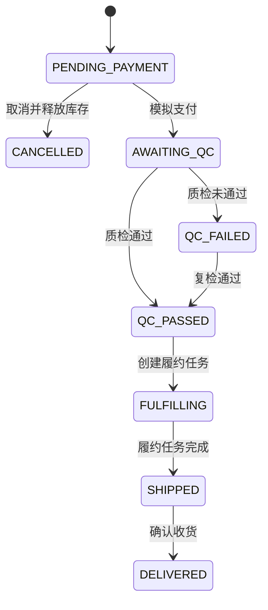

# 丝路智链：一笔教学订单的一致性设计

本案例围绕营销审核、客户下单、质检、履约回执与售后，说明一次订单如何在重复请求、并发库存和不同账号之间保持业务约束。以下依据本地实际源码整理，审计日期为 **2026-10-16**。

**这里的代码均为解释设计的小型伪代码，不是原始可运行后端，也不能替代完整服务、数据库迁移与部署配置。** 文中源码路径以原项目根目录为起点，作为阅读定位信息；当前展示目录没有发布完整后端。

## 项目基础与来源

项目是在既有学院办公与归档应用基础上做的业务改造，复用登录会话、学院隔离、账号资料、通用布局及个人模型配置等能力。前端使用 Vue 3、TypeScript、Vite、Element Plus 与 Pinia；后端使用 Java 8、Spring Boot、MyBatis Plus 与 MySQL，订单业务通过 Spring JDBC 和事务实现。

前端基础来自 MIT 许可的 [vue-next-admin](https://gitee.com/lyt-top/vue-next-admin)，原作者信息见 `CropDiseasesDetection_vue/package.json`。这一案例展示业务改造与验证材料，不代表完整框架、旧系统或所有模块均为独立原创。复用与旧入口清理见原项目 `docs/silkroad-cleanup.md`。

## 1. 状态约束：操作需要满足前置条件

订单以服务端保存的状态为准。模拟支付后才能质检，质检通过后才能创建履约任务，任务完成后才标记出库，确认收货是另一次操作。



履约任务有单独的顺序：`QUEUED → INSPECTING → LOCATING → PICKING → COMPLETED`。任何非终态都可报告 `FAILED`；失败后须显式重试，从 `QUEUED` 重新经过全部阶段。任务终态不接受新的推进事件，同一事件的相同重放可以返回现有结果。

```text
transaction applyTaskEvent(actor, taskId, event):
    require administrator
    lock authorized order, then its task
    require event.source == task.mode
    if event.id already exists:
        require same type, source and message
        return current task
    require task is neither FAILED nor COMPLETED
    require event.type == FAILED or next stage after task.status
    update task and append event
    if event.type == COMPLETED: mark order SHIPPED
```

`SIMULATION` 与 `DEVICE` 的回执来源必须和任务模式匹配。`DEVICE` 是等待现场适配器读取和回传的接口边界，没有多网关独占领取租约，也没有建立真实机器人动作的验证结论。出库 `SHIPPED` 不等于跨境运输已送达。

实际设计定位：`CropDiseasesDetection_springboot/src/main/java/com/example/Kcsj/service/SilkRoadService.java` 中的 `pay`、`qc`、`createTask`、`taskEvent`、`retry`、`receive` 与 `lockTask`。

## 2. 库存与幂等：重复提交不能重复扣减

创建订单使用 `READ_COMMITTED` 事务。请求包含 `requestId`，业务内容经规范化后计算哈希，幂等查询限定为同学院、同用户、同请求标识。相同内容重试返回已有订单；相同标识提交不同内容会被拒绝。

商品按 ID 升序加行锁，并在锁定后再次查询已有订单，处理等待另一次提交完成的重试。数量、上架状态、库存和单价都在服务端校验；总价使用数据库商品价格与 `BigDecimal` 计算，不信任客户端金额。全部明细检查通过后，订单快照、库存扣减及创建事件在同一事务中提交。

```text
transaction READ_COMMITTED createOrder(actor, request):
    validate items, positive quantities and unique product IDs
    items = sortByProductId(request.items)
    digest = hash(normalize(customer, country, address, items))
    if existing(actor.college, actor.id, request.id):
        require stored digest == digest; return stored order
    products = lock permitted products in ascending ID order
    repeat existing-request check after obtaining locks
    require every product is active and stock >= requested quantity
    total = sum(database unit price * quantity)
    save order with price/item snapshot and digest
    reserve stock; append ORDER_CREATED; commit
```

取消操作先锁定订单，只允许待支付订单取消。已取消订单再次提交直接返回原结果，因此不会再次返还库存。支付、取消和后续状态推进都通过服务端状态检查处理；售后申请与人工结案不自动产生退款。

已有业务测试包含相同请求并发重试、竞争最后库存、非法明细及库存不足回滚。它们支持这些已覆盖场景的结论，不代表已经完成分布式多节点、支付故障恢复或生产容量验证。

实际设计定位：同一 `SilkRoadService.java` 中的 `createOrder`、`existingRequest`、`product`、`cancel`。相关用例位于 `CropDiseasesDetection_springboot/src/test/java/com/example/Kcsj/SilkRoadWorkflowTest.java`。

## 3. 权限与打印：详情页仍需服务端授权

查询同时限制学院范围和订单归属。普通客户只能读取自己的订单、任务及售后；管理员只能在本学院范围内管理。历史分页、搜索、详情、任务详情与打印数据都经过后端权限判断，不能仅依靠前端菜单隐藏。

```text
readOrder(actor, orderId):
    order = query by orderId AND actor.collegeId
    reject when absent
    require actor is administrator OR order.userId == actor.id
    return persisted items, total and authorized event history

openPrintView(orderId):
    clear previous order; show loading state
    fetch authorized order detail from server
    discard response if page, request version or session changed
    render A4 document only after a successful response
```

打印页使用独立路由 `/order-print/:id`，读取 `/api/silkroad/orders/{id}`，不把总览最近 200 条列表当作详情数据源。加载前清空上一次订单，异步响应使用请求版本、当前会话和卸载标记防止过期数据覆盖。凭单明确说明模拟支付、无真实机器人动作，以及不能用作发票、真实扣款凭证或报关材料。

页面提供浏览器打印与保存 PDF 的入口，已有记录覆盖页面内容及新标签页恢复；没有实际打印机或不同纸张设置的验证结论。

实际设计定位：

- `CropDiseasesDetection_springboot/src/main/java/com/example/Kcsj/service/SilkRoadService.java`：`orderDetail`、`orderTask`、`order`、`requireOwner`、`scope`。
- `CropDiseasesDetection_springboot/src/main/java/com/example/Kcsj/controller/SilkRoadController.java`：订单详情及任务详情接口。
- `CropDiseasesDetection_vue/src/views/silkroad/print-order.vue`：`load`、打印状态、A4 样式及教学说明。
- `CropDiseasesDetection_vue/src/router/route.ts`：独立打印路由。

## 4. AI 来源边界：生成内容不能冒充业务事实

营销区分 `TEMPLATE` 与 `AI`：模板模式直接生成带来源标签的文案；AI 模式调用当前用户的个人模型配置。返回内容是营销文案、待制作图像提示词和视频分镜，不能标为已生成图片或视频。修改营销素材后需重新审核。

客服的订单资料先经服务端权限校验，再构造字段白名单。姓名、地址、用户 ID 与自由填写的事件备注不进入模型的结构化订单上下文；问题与输出还经过脱敏处理。这是已实现的字段约束，不应扩展为对任意自由文本的绝对隐私保证。

```text
answer(actor, question, optionalOrderId, mode):
    order = authorize order before adding its business context
    safeContext = whitelist products, order facts and policy
    references = references generated from this permitted context
    if mode == KNOWLEDGE: return local knowledge answer
    output = call configured model with rules and safeContext
    require strict JSON, exact fields and bounded string lengths
    require every cited reference belongs to references
    return redacted answer with server-assigned source AI
```

来源标签由服务端分支赋值，模型不能自行宣称来自模板或知识库。JSON 解析拒绝重复字段及尾随内容；引用必须落在服务端提供的允许集合中。模型不可用时应报告失败，不将失败悄悄计作模板生成成功。来源校验有助于追踪回答依据，但不等于已经证明生成文本中的每个事实都正确。

客服依据结构化商品、订单与政策做检索和上下文组织，没有向量数据库或完整向量 RAG 的实现证据。AI 不能执行退款、支付、发货或设备控制。

实际设计定位：

- `CropDiseasesDetection_springboot/src/main/java/com/example/Kcsj/service/SilkRoadAiService.java`：`generate`、`answer`、`retrieve`、`order`、`redact` 及严格 JSON 解析。
- `CropDiseasesDetection_springboot/src/main/java/com/example/Kcsj/service/SilkRoadService.java`：客服上下文构造与营销素材审核。
- `CropDiseasesDetection_springboot/src/test/java/com/example/Kcsj/SilkRoadAiServiceTest.java`：模拟上游、格式拒绝、引用范围与上下文边界用例。

## 验证记录如何阅读

[验证清单](verification.json)记录已有五类后端测试报告，共 **41 项，通过 41 项，失败 0、错误 0、跳过 0**：业务 9、模拟 AI 12、账户 11、共享会话 6、容量过滤 3。本轮只审计已有记录，没有重新运行测试，也没有调用真实模型、邮件或设备。

原记录日期为 2026-10-15；XML 没有执行时间戳属性，清单分别保存文档日期、文件修改时间与 SHA-256，避免将文件时间冒充精确执行时间。原报告未公开，哈希只用于后续比对同一文件，不能替代可下载报告或独立复现。

后续最有价值的补充是可独立复现的隔离环境、经过净化的业务截图，以及真实设备适配后的逐项联调记录。真实支付、邮件、承运商、清关、媒体生成及生产压测均不在当前通过结论内。
