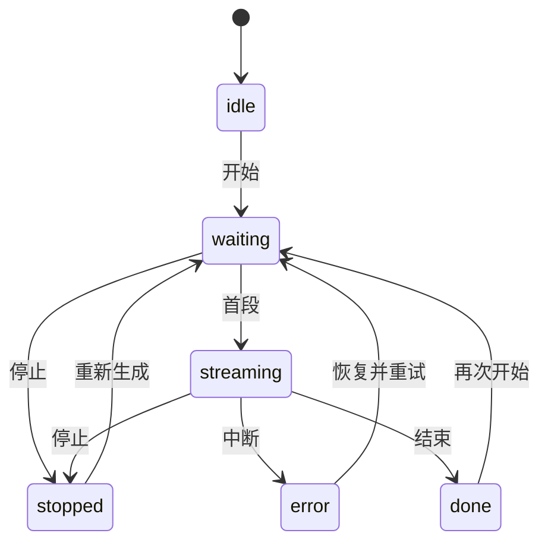

# 流式回答交互实验

[在线演示](https://guhang2011.github.io/demos/ai-stream/) · [实现笔记](../../notebook/streaming-ui-decisions.html) · [主页返工记录](../../notebook/portfolio-rework.html)

React + TypeScript + Ant Design 的客户端学习示例。选择预设话题，观察等待、逐段输出、停止、中断和重试。2026-11-08 新增，采用 AI 辅助实现与整理。

## 体验顺序

1. 正常输出：开始后等待完整内容，完成后可复制文字。
2. 慢速连接：收到首段前点击停止，等待后检查是否有旧文字出现。
3. 中途断开：收到部分内容后显示错误，保留已有文字。点击“恢复连接并重试”，清空旧文字并从头生成。
4. 输出中点击清空，立刻切换话题重新开始。上一轮不能更新新回答。

## 实现

- `src/stream.ts`：独立状态控制器；每次尝试使用单调递增的归属序号，停止与重置同时触发 AbortController。
- `src/App.tsx`：真实 Ant Design 的 Button、Select、Radio、Alert 和 ConfigProvider。正文按纯文本渲染；状态消息在阶段变化时播报。
- `tests/stream.test.ts`：可控制的异步源，故意忽略 abort，验证迟到成功、失败与完成都被隔离。
- `assets/stream.js`：由源码构建的本地 bundle，页面无需 CDN。



任何状态都可以清空并回到 idle。等待阶段也可发生错误。重试明确从头开始，没有断点续传；模拟的失败模式在恢复时切回正常，界面同步显示该变化。

## 复现

克隆完整站点后进入 `demos/ai-stream`。依赖版本来自锁文件，React 18.3.1、Ant Design 6.6.8。

```sh
npm ci
npm test
npm run build
```

然后在网站仓库根目录运行 `python -m http.server 8000`，打开 `http://localhost:8000/demos/ai-stream/`。需要 Node.js 22.18+；测试使用内置 TypeScript 类型剥离。生产产物已提交，直接查看线上页面不需要安装依赖。

## 运行范围

使用两段中文预设文本，没有语言模型调用、API 密钥或用户输入上传；慢速和失败为确定性本地模拟。浏览器取消不等于真实服务端停止推理或计费。接入服务时需要另外处理 SSE 解析、超时、鉴权及服务端取消协议。

[验证范围与结果](../../reviews/portfolio-practice-20261108.md)。源码附十项核心测试，UI 另做浏览器检查。模型效果、服务延迟与生产可靠性不属于本例的测试范围。

## 第三方许可

React 与相关构建依赖见 [THIRD-PARTY-LICENSES.txt](THIRD-PARTY-LICENSES.txt)；Ant Design 及依赖见 [ANT-DESIGN-LICENSES.txt](ANT-DESIGN-LICENSES.txt)。字体复用站点的 [IBM Plex Sans](../../assets/fonts/OFL.txt)。
